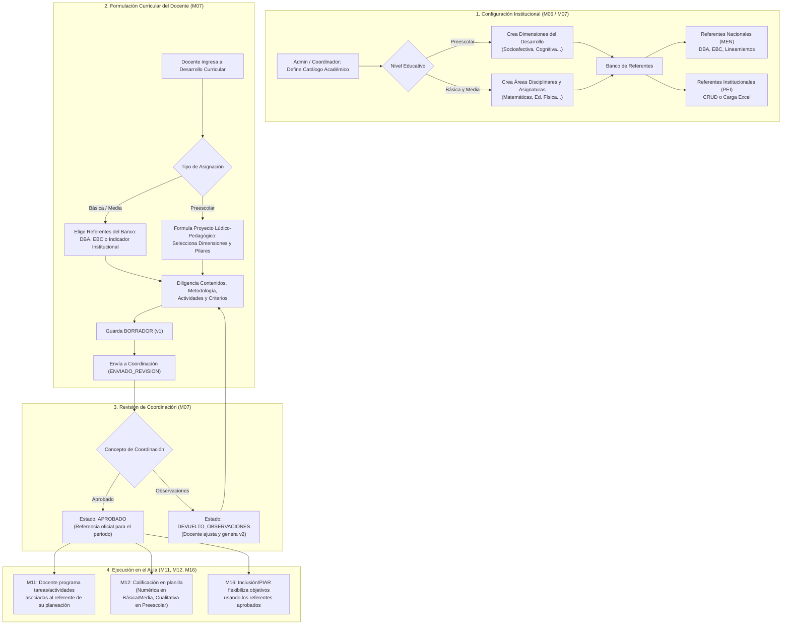

# Análisis M07 — Currículo, Banco de Referentes y Desarrollo Curricular (con implicaciones en M06, M11, M12 y M16)

Documento de análisis técnico, normativo y pedagógico sobre el estado actual del Módulo 07 en Klassy, la confrontación con la visión de `Idea_Klassy`, la normativa colombiana vigente (Ley 115 de 1994, Decreto 2247 de 1997 / Decreto 1075 de 2015, Decreto 1290 de 2009) y el rediseño requerido para garantizar la regla de oro: **100% configurable y cero datos quemados**.

---

## 1. Contexto y Objetivos del Análisis

El propósito de este documento es evaluar a profundidad el funcionamiento actual del **Módulo 07 (Matriz curricular, banco de referentes y desarrollos curriculares)** frente a:
1. **La regla transversal de Klassy**: *"Todo debe ser configurable por la institución; ningún catálogo, ponderación o referente debe venir rígidamente quemado en el sistema"*.
2. **La realidad curricular y normativa del Sistema Educativo Colombiano**:
   - El Ministerio de Educación Nacional (MEN) **no** ha expedido Derechos Básicos de Aprendizaje (DBA) para todas las áreas del conocimiento.
   - El nivel de **Educación Preescolar** posee un régimen pedagógico y legal completamente diferenciado (Decreto 2247 de 1997 compilado en el Decreto 1075 de 2015): no opera bajo áreas ni asignaturas tradicionales, prohíbe la reprobación numérica y exige evaluación cualitativa-descriptiva sobre **Dimensiones del Desarrollo**, articulada a través de **Actividades Rectoras** y **Proyectos Lúdico-Pedagógicos**.
3. **El impacto multidireccional en otros módulos**:
   - **M06 (Plan de Estudios y Catálogo Académico)**: Rigidez en la jerarquía `Área -> Asignatura -> Ponderación %`.
   - **M08 (Carga Docente)**: Asignación académica en preescolar (docente titular integral vs. docente por materia).
   - **M11 (Actividades y Tareas)** y **M12 (Planillas y Calificaciones)**: Dependencia forzada del campo `dba_id` y componentes evaluativos cuantitativos.
   - **M16 (PIAR e Inclusión)**: Dependencia de `dba_ids` para los objetivos de flexibilización curricular en el Anexo 2.

---

## 2. Diagnóstico del Estado Actual (Código vs. Documentación)

### 2.1. Lo que planteó la documentación inicial (`Idea_Klassy`)
En la documentación `Idea_Klassy_Gestor_Academico_Administrativo_v2.docx`:
- **Párrafo 444–448**: Se propuso incluir un "banco precargado de referentes curriculares, DBA y estándares" y relacionar DBA con grado, área, asignatura y periodo.
- **Párrafo 521–522 (El pre-requisito y el enlace pedagógico)**: Se estipuló que antes de crear tareas en M11, el docente debía crear su Desarrollo Curricular en M07 seleccionando DBAs. Se asumió textualmente: *"Cuando el docente diseña un examen o taller en M11, el formulario debe incluir un selector obligatorio que le pregunte: '¿Qué DBA o competencia de su planeación aprobada evalúa esta actividad?'"*.
- **Sesgo originario**: La documentación asumió que el modelo pedagógico nacional se fundamenta de forma uniforme en los **DBA** para todas las materias y grados escolares.

### 2.2. Cómo está implementado hoy en el Backend

1. **Modelo `ReferenteCurricular` (`backend/src/models/referenteCurricular.model.ts`)**:
   - Colección `m07_referentes_curriculares` con discriminadores: `'DBA'`, `'EBC'`, `'LINEAMIENTO'`.
   - Aunque la base de datos permite discriminadores, **el modelo está sesgado al DBA**:
     - `Dba` exige `area_id`, `grade_id`, `numero_dba`, `organizador`.
     - `Ebc` exige `area_id`, `grupo_grados`, `competencia`, y almacena un array `dba_relacionados`.
     - `Lineamiento` solo permite `titulo`, `contenido`, `orden`.
   - **No existe ningún mecanismo de gestión para que la institución cree o importe sus propios referentes o indicadores**.
2. **Semillero Estático `seedReferentesCurriculares.ts` (`backend/scripts/seedReferentesCurriculares.ts`)**:
   - Carga estáticamente 4 archivos JSON: `dbaMatematicas.json`, `dbaLenguaje.json`, `dbaCienciasNaturales.json`, `dbaCienciasSociales.json`, `ebc.json`, `lineamientos.json`.
   - Mapea las áreas del colegio hacia el seed mediante expresiones regulares quemadas (`ASIGNATURA_POR_AREA`):
     ```typescript
     const ASIGNATURA_POR_AREA: Record<string, RegExp> = {
       'MAT-BAS': /matem[aá]tica/i,
       'LEN-CAS': /lengua\s*castellana/i,
       'CNAT-BAS': /ciencias\s*naturales/i,
       'CS-HGD': /ciencias\s*sociales/i,
     };
     ```
   - Si la institución usa nombres distintos o imparte asignaturas donde el MEN no publicó DBAs (ej. Tecnología, Educación Física, Filosofía, Danzas, Robótica), el banco queda completamente vacío para esas materias.
3. **Modelo `CurricularDevelopment` (`backend/src/models/curricularDevelopment.model.ts`)**:
   - Contrato rígido:
     - `teacher_assignment_id: Types.ObjectId`: Exige una asignación de tipo `CLASE`.
     - `periodo_numero: number`: Delimitado a periodos regulares (1 a 4).
     - `dba_seleccionados: Types.ObjectId[]`: Nombre explícito que asume que solo se seleccionan DBAs.
     - Contenidos temáticos, ejes temáticos, competencias, metodología, criterios de evaluación: estructurados para asignaturas disciplinares tradicionales.
4. **Servicio `curricularDevelopment.service.ts`**:
   - La función `validateDbaSeleccionados` valida que los IDs seleccionados pertenezcan estrictamente al discriminador `Dba` (`Dba.find({ _id: { $in: dbaIds }, estado: ESTADO_ACTIVO })`).
   - **Consecuencia**: Un docente **no puede** seleccionar un EBC, ni un Lineamiento, ni un indicador institucional como referente estructurante de su planeación, porque el servicio rechaza cualquier ID que no sea un `Dba`.
5. **Acoplamiento con M11/M12 (`activity.service.ts` y `activity.model.ts`)**:
   - `Activity.dba_id: Types.ObjectId | null`.
   - `validarReferente(planeacion, dba_id, competencia_evaluada)`: En M11, el docente está forzado a elegir un `dba_id` de la lista de DBAs aprobados, o un renglón de texto libre de `competencias`.
6. **Acoplamiento con M16 PIAR (`ajusteAsignatura.model.ts` y `ajusteAsignatura.service.ts`)**:
   - `AjusteAsignatura.dba_ids: Types.ObjectId[]`.
   - En el frontend (`AjustesPanel.tsx`), la consulta filtra rígidamente:
     ```typescript
     useReferentes({ grade_id: gradeId, area_id: fila.area_id, tipo_referente: 'DBA' });
     ```
     Dejando sin objetivos curriculares a cualquier estudiante con NEE en asignaturas como Educación Física, Música, Dibujo o Informática.

### 2.3. Cómo está implementado hoy en el Frontend (`DesarrolloCurricularPage.tsx`)

1. **Diseño de Interfaz enfocado exclusivamente en DBA**:
   - Pestaña 1: *"Banco de DBA"* (Interactiva, con checkboxes para seleccionar).
   - Pestaña 2: *"EBC y Lineamiento (apoyo)"* (Estática, de mera lectura).
2. **Experiencia del docente de asignaturas sin DBA**:
   - Un docente de Educación Física, Religión, Ética, Tecnología o Filosofía selecciona su curso y ve:
     > *"No se encontraron referentes en el banco para este grado y área."*
   - No tiene botón de "Crear referente", no puede importar los estándares de la Guía 30 (Tecnología) o Guía 21 (Artística), y no puede seleccionar los EBC de la pestaña de apoyo. Queda en un "limbo pedagógico".

---

## 3. Matriz de Falencias Críticas Detectadas

| # | Dimensión | Falencia Detectada en M07 / M06 | Causa Raíz | Impacto en la Práctica Escolar |
|---|---|---|---|---|
| **F-01** | **Principios Klassy** | Banco precargado estático y monolítico sin opción de configuración institucional. | Se asumió que el MEN es la única fuente y que los 4 JSONs quemados cubrían todo. | Violación de la regla "Todo debe ser configurable". El colegio no puede cargar sus propios logros, indicadores del PEI ni mallas institucionales. |
| **F-02** | **Normativa Nacional** | Falacia de "Todo tiene DBA". Solo 5 áreas + Transición tienen DBA oficiales en Colombia. | Desconocimiento del estado real de las publicaciones del MEN desde 2016. | Bloqueo o desprotección para docentes de Educación Física, Artística, Tecnología, Filosofía, Ética, Religión y modalidades técnicas. |
| **F-03** | **Pedagogía Infantil** | Desconocimiento del régimen de Preescolar (Decreto 2247/1997 y Dec. 1075/2015). | M06 modeló rígidamente `Área -> Asignatura -> Ponderación %` para todos los grados por igual (-2 a 11). | Forzamiento de "materias ficticias" (Pre-matemáticas, Pre-escritura) y escalas numéricas prohibidas expresamente por ley en preescolar. |
| **F-04** | **Arquitectura de Datos** | Nomenclatura acoplada y campos rígidos (`dba_id`, `dba_seleccionados`, `dba_ids`). | Se bautizaron las columnas de BD y APIs con el nombre de un documento específico (DBA) en vez de una abstracción pedagógica genérica. | Deuda técnica masiva que contagió a M11, M12, M16 y scripts de migración. |
| **F-05** | **Didáctica y Planeación** | Enfoque exclusivo de planeación por "Asignatura Disciplinar". | M07 solo se activa por `TeacherAssignment` de tipo `CLASE` asociada a un `subject_id`. | Imposibilidad de planear Proyectos Transversales (Ley 115 Art. 14: Educación Sexual, Democracia, Medio Ambiente) y Proyectos Lúdico-Pedagógicos de Preescolar. |
| **F-06** | **Autonomía Escolar** | Vulneración del Art. 77 de la Ley 115 de 1994 (Autonomía Curricular Institucional). | El sistema no tiene CRUD ni importador de referentes institucionales para el Coordinador o Rector. | Los colegios con enfoques pedagógicos propios (Montessori, Waldorf, Educación Popular, colegios técnicos comerciales o industriales) no pueden adaptar el software. |

---

## 4. Marco Pedagógico y Legal Colombiano (La Realidad Aplicada)

Para estructurar la solución correcta, es imperativo fundamentar el diseño en la legislación y lineamientos del Ministerio de Educación Nacional de Colombia:

```
                                  JERARQUÍA CURRICULAR NACIONAL (COLOMBIA)
                                  
  ┌────────────────────────────────────────────────────────────────────────────────────────┐
  │ 1. Lineamientos Curriculares (1998)                                                    │
  │    Orientaciones epistemológicas, pedagógicas y didácticas generales del MEN.         │
  └──────────────────────────────────────────┬─────────────────────────────────────────────┘
                                             ▼
  ┌────────────────────────────────────────────────────────────────────────────────────────┐
  │ 2. Estándares Básicos de Competencias - EBC (Guías MEN: 6, 7, 21, 30, etc.)           │
  │    Criterios públicos de lo que deben saber y saber hacer. Estructurados por GRUPOS    │
  │    DE GRADOS (1°-3°, 4°-5°, 6°-7°, 8°-9°, 10°-11°). Aplica a la gran mayoría de áreas.│
  └──────────────────────────────────────────┬─────────────────────────────────────────────┘
                                             ▼
  ┌────────────────────────────────────────────────────────────────────────────────────────┐
  │ 3. Derechos Básicos de Aprendizaje - DBA (2015 - 2016)                                 │
  │    Aprendizajes estructurantes año por año.                                            │
  │    * SOLO EXISTEN PARA: Matemáticas, Lenguaje, Ciencias Naturales, Ciencias Sociales,  │
  │      Inglés y Transición.                                                              │
  │    * NO EXISTEN PARA: Ed. Física, Artística, Tecnología, Ética, Religión, Filosofía.   │
  └──────────────────────────────────────────┬─────────────────────────────────────────────┘
                                             ▼
  ┌────────────────────────────────────────────────────────────────────────────────────────┐
  │ 4. Mallas de Aprendizaje y Orientaciones Pedagógicas (MEN)                             │
  │    Propuestas de secuenciación de aula y situaciones problema.                         │
  └──────────────────────────────────────────┬─────────────────────────────────────────────┘
                                             ▼
  ┌────────────────────────────────────────────────────────────────────────────────────────┐
  │ 5. Autonomía Curricular Institucional (Ley 115 de 1994, Art. 77)                       │
  │    El PEI de cada institución define sus propios objetivos, logros, asignaturas        │
  │    optativas, modalidades técnicas y planes de estudio.                                │
  └────────────────────────────────────────────────────────────────────────────────────────┘
```

### 4.1. El caso de Preescolar (Primera Infancia)
1. **Marco Normativo**: Decreto 2247 de 1997, compilado en el Decreto 1075 de 2015 (Título 3).
2. **Artículo 10**: *«En el nivel de educación preescolar no se reprueban grados ni actividades. Los educandos avanzarán en el proceso educativo, según sus capacidades y aptitudes personales, por lo que las instituciones educativas diseñarán mecanismos de evaluación cualitativa...»*.
3. **Artículo 14**: *«La evaluación en el nivel de educación preescolar es un proceso integral, sistemático, permanente, participativo y cualitativo. Tiene como propósitos: conocer el estado del desarrollo integral del educando y de sus avances...»*.
4. **Estructura Pedagógica Obligatoria**:
   - **Dimensiones del Desarrollo Humano**:
     - *Socioafectiva*
     - *Corporal*
     - *Comunicativa*
     - *Cognitiva*
     - *Ética*
     - *Estética*
     - *Espiritual* (según el PEI institucional)
   - **Actividades Rectoras (Política de Estado 'De Cero a Siempre' y Lineamientos MEN)**:
     - *El Juego*
     - *El Arte*
     - *La Literatura*
     - *La Exploración del Medio*
   - **Metodología de Aula**: Proyectos Lúdico-Pedagógicos y Rincones de Aprendizaje, nunca clases magistrales fraccionadas por asignaturas de 45 minutos.

---

## 5. Arquitectura Propuesta: Reestructuración Integral de M06 y M07

Para resolver estas falencias sin destruir la trazabilidad del sistema, se propone un rediseño que armoniza el Catálogo Académico (M06) con el Currículo (M07) y sus consumidores (M11, M12, M16).

### 5.1. Ajuste en M06 (Catálogo Académico y Plan de Estudios)

El Catálogo Académico no debe asumir que toda unidad curricular es un "Área disciplinar" con "Asignaturas hijas":
1. **Entidad `Area` polimórfica / tipificada (`tipo_estructura`)**:
   - `tipo_estructura: 'AREA_DISCIPLINAR' | 'DIMENSION_DESARROLLO'`
   - Para Básica y Media (1° a 11°): `AREA_DISCIPLINAR` (ej. Matemáticas $\rightarrow$ Asignaturas: Cálculo, Estadística, Álgebra).
   - Para Preescolar (-2 a 0: Pre-jardín, Jardín, Transición): `DIMENSION_DESARROLLO` (ej. *Dimensión Cognitiva*, *Dimensión Comunicativa*, *Dimensión Corporal*).
2. **Tratamiento en `Subject` (Asignatura)**:
   - Para Preescolar, no se crean asignaturas ficticias ("Pre-matemáticas"). La Dimensión puede operar de dos maneras configurables por la institución:
     - **Modo A (Directo por Dimensión)**: La Dimensión es la unidad evaluativa y de planeación directa (sin hijos).
     - **Modo B (Ejes / Proyectos)**: Sub-unidades denominadas *Proyectos Pedagógicos* o *Ejes Experienciales* (ej. "Proyecto: Descubriendo mi entorno").
3. **Regla de Ponderación en `StudyPlan` (M06)**:
   - En grados donde el nivel sea `PREESCOLAR`, el motor del plan de estudios **no debe exigir** que las ponderaciones sumen 100% ni exigir métodos numéricos (`PONDERADO`/`ARITMETICO`). Se marca automáticamente como evaluación `CUALITATIVA_DESCRIPTIVA`.

---

### 5.2. Ajuste en M07: Banco de Referentes Curriculares 100% Configurable

Se transforma el modelo de `ReferenteCurricular` para soportar la jerarquía curricular real de Colombia y la autonomía de cada colegio:

```
                           MODELO UNIFICADO: ReferenteCurricular
                                             
   Campos Comunes:
   ├── _id: ObjectId
   ├── institucion_id: ObjectId | null   (null = Oficial MEN nacional; ObjectId = Creado por el colegio)
   ├── tipo_referente: TipoReferente
   ├── area_id: ObjectId | null          (null para lineamientos transversales)
   ├── grade_id: ObjectId | null         (null si aplica a grupo de grados)
   ├── grupo_grados: GrupoGrados | null  ('1-3', '4-5', '6-7', '8-9', '10-11')
   ├── codigo: string                    (ej. "DBA-MAT-01", "EBC-LEN-04", "LOGRO-INST-101")
   ├── enunciado / descripcion: string
   ├── evidencias_aprendizaje: string[]
   ├── estado: 'activo' | 'inactivo'     (Vigente vs. Histórico)
   └── fuente: string                    ('MEN Oficial', 'PEI Institucional', 'Guía 30', etc.)
```

#### Tipos de Referente Curricular (`tipo_referente`)
1. **`DBA`** (Derecho Básico de Aprendizaje): Aprendizaje estructurante anual oficial del MEN.
2. **`ESTANDAR_EBC`** (Estándar Básico de Competencias): Competencias oficiales por grupos de grados (Guías 6, 7, 21, 30, etc.).
3. **`LINEAMIENTO_NACIONAL`**: Orientaciones y mallas curriculares del MEN.
4. **`REFERENTE_INSTITUCIONAL` / `INDICADOR_DESEMPENO`**: Creado por la institución educativa (coordinación o docentes) bajo el Art. 77 de la Ley 115 para cubrir:
   - Educación Física, Recreación y Deportes.
   - Educación Artística y Cultural.
   - Tecnología e Informática / Robótica.
   - Educación Religiosa, Ética y Valores.
   - Filosofía.
   - Asignaturas Técnicas (SENA, agropecuaria, industrial, comercial).
   - Cátedras institucionales (Cátedra de Paz, Emprendimiento, Educación Vial).
5. **`DIMENSION_EXPERIENCIA`** (Para Preescolar): Descriptores de desarrollo, actividades rectoras y DBA de Transición estructurados alrededor de las Dimensiones del Desarrollo.

#### Funcionalidades Nuevas para Cumplir la Regla de Oro Klassy:
- **CRUD Institucional de Referentes**: Interfaz para que el ADMIN o COORDINADOR cree, edite y desactive referentes institucionales.
- **Importador Masivo (Excel / CSV)**: Siguiendo el estándar de importación limpia de Klassy (usado en M15 Faltas), permitiendo a la institución subir su banco completo de logros e indicadores institucionales.

---

### 5.3. Ajuste en M07: Desarrollo Curricular (Planeación de Aula)

El modelo `CurricularDevelopment` debe adaptarse al tipo de unidad pedagógica que planifica el docente:

```
                         DESARROLLO CURRICULAR FLEXIBLE
                                       
                    ¿Qué tipo de estructura se planea?
                                       │
                 ┌─────────────────────┴─────────────────────┐
                 ▼                                           ▼
      [ BÁSICA Y MEDIA (1°-11°) ]                 [ PREESCOLAR (-2 a 0) ]
      Planeación Disciplinar                      Planeación Lúdico-Pedagógica
      
  ├── Referentes Seleccionados:               ├── Dimensiones Articuladas:
  │   (Cualquier tipo: DBA, EBC,                  (Cognitiva, Comunicativa, Corporal...)
  │    o Indicador Institucional)             ├── Actividades Rectoras / Pilares:
  ├── Contenidos Temáticos                    │   (Juego, Arte, Literatura, Exploración)
  ├── Competencias a Desarrollar              ├── Nombre del Proyecto / Centro de Interés:
  ├── Metodología y Recursos                      (ej. "Los habitantes de mi jardín")
  ├── Criterios de Evaluación                 ├── Descriptores Cualitativos de Avance
  └── Semanas Proyectadas                     └── Observaciones de Acompañamiento
```

#### Nombres de campos y retrocompatibilidad técnica:
- Renombrar conceptualmente `dba_seleccionados` $\rightarrow$ `referentes_seleccionados: Types.ObjectId[]`.
- En Mongo, para evitar migraciones destructivas inmediatas, `referentes_seleccionados` puede conservar `dba_seleccionados` como alias en el schema o mediante migración de esquema segura.
- El validador `validateReferentesSeleccionados` aceptará cualquier referente vigente en la colección `ReferenteCurricular` que corresponda al grado o grupo de grados y área de la asignación, sea este un `DBA`, un `EBC`, un `LINEAMIENTO` o un `REFERENTE_INSTITUCIONAL`.

---

### 5.4. Ajuste en Módulos Consumidores (M11, M12, M16)

1. **M11 (Actividades de Aula - `Activity`)**:
   - El campo `dba_id` en `Activity` pasa a representar `referente_id` (apuntando a `ReferenteCurricular`).
   - En el frontend (`ActividadDrawer.tsx`):
     - El selector deja de llamarse rígidamente *"DBA de tu planeación"* y pasa a llamarse:
       **«Referente de tu planeación (DBA, Estándar o Indicador)»**.
     - Lista todos los referentes aprobados en la planeación de ese periodo.
2. **M12 (Evaluación y Planillas)**:
   - Para Preescolar:
     - No genera planillas con notas de 1.0 a 5.0 ni porcentajes de heteroevaluación.
     - Genera la planilla de **Juicios Valorativos / Descriptores de Avance Cualitativo** (ej. *En Proceso, Alcanzado, Requiere Apoyo* o texto descriptivo según el SIEE del colegio).
3. **M16 (PIAR e Inclusión - `AjusteAsignatura`)**:
   - `AjusteAsignatura.dba_ids` pasa a llamarse/operar como `referentes_ids`.
   - El panel de ajustes (`AjustesPanel.tsx`) consulta referentes sin filtrar rígidamente `tipo_referente: 'DBA'`. Permite seleccionar Estándares EBC e Indicadores Institucionales, desbloqueando el PIAR para asignaturas artísticas, deportivas y técnicas.

---

## 6. Flujo de Trabajo Pedagógico Completo (Workflow)



---

## 7. Plan de Implementación y Hoja de Ruta

Para ejecutar esta transformación sin interrumpir las operaciones existentes de Klassy, se divide el plan de trabajo en 4 fases ordenadas:

### Fase 1: Desacoplamiento del Banco de Referentes (M07 Backend)
1. Modificar `referenteCurricular.model.ts`:
   - Añadir soporte para `institucion_id` (opcional; null = nacional).
   - Incorporar enums de tipo de referente: `['DBA', 'ESTANDAR_EBC', 'LINEAMIENTO_NACIONAL', 'REFERENTE_INSTITUCIONAL', 'INDICADOR_DESEMPENO', 'DIMENSION_EXPERIENCIA']`.
2. Actualizar `referenteCurricular.service.ts`:
   - Habilitar CRUD de referentes institucionales para ADMIN y COORDINADOR.
   - Crear servicio de importación masiva Excel/CSV (`importacionReferentes.service.ts`) con validación atómica.
3. Actualizar `curricularDevelopment.service.ts`:
   - En `validateDbaSeleccionados`, validar contra cualquier referente activo en `ReferenteCurricular` (no solo discriminador `Dba`).

### Fase 2: Flexibilización de la Interfaz Docente y Coordinador (M07 Frontend)
1. Modificar `DesarrolloCurricularPage.tsx`:
   - Renombrar pestaña "Banco de DBA" a **«Banco de Referentes Curriculares»**.
   - Permitir filtrar por tipo de referente (`DBA`, `EBC`, `Institucional`).
   - Permitir seleccionar directamente cualquier referente aplicable al grado y área.
   - Habilitar selector de referentes institucionales creados por el colegio.
2. Modificar `RevisionCurricularPage.tsx`:
   - Mostrar el tipo de referente en el drawer de revisión (badge indicando si es DBA, EBC o Indicador Institucional).
3. Crear pantalla de gestión de referentes en administración (`CatalogoReferentesPage.tsx` en `/admin/curriculo/referentes`).

### Fase 3: Integración de Preescolar en M06 y M07
1. En `area.model.ts` y `Area`:
   - Agregar campo `tipo_unidad: 'AREA_DISCIPLINAR' | 'DIMENSION_DESARROLLO'` (default `'AREA_DISCIPLINAR'`).
2. En `studyPlan.service.ts` y `studyPlan.validator.ts`:
   - Omitir validación de suma 100% de ponderaciones cuando el grado pertenezca a nivel `PREESCOLAR`.
3. En `DesarrolloCurricularPage.tsx`:
   - Si la asignación corresponde a Preescolar, adaptar el formulario para destacar Dimensiones del Desarrollo, Actividades Rectoras y Proyectos Lúdico-Pedagógicos.

### Fase 4: Armonización con Módulos Consumidores (M11, M12, M16)
1. En `Activity` (M11):
   - Actualizar etiquetas en `ActividadDrawer.tsx` para mostrar "Referente evaluado (DBA / EBC / Indicador)".
2. En `AjusteAsignatura` (M16 PIAR):
   - Eliminar el filtro restrictivo `{ tipo_referente: 'DBA' }` en `AjustesPanel.tsx` para que permita flexibilizar con cualquier referente del área.
3. En `ColumnaPlanilla` / `Notas` (M12):
   - Asegurar que Preescolar no aplique fórmulas ponderadas sino escalas cualitativas de avance.

---

## 8. Conclusión

El diseño actual del Módulo 07 presentaba un sesgo restrictivo derivado de una interpretación simplificada de la educación colombiana, al suponer que todas las materias se rigen por DBAs y que todos los grados responden al esquema tradicional de áreas y asignaturas.

Con la reestructuración aquí definida:
1. **Klassy recupera su principio fundacional**: todo se vuelve configurable y adaptable a cualquier colegio de Colombia (académico, técnico, bilingüe o alternativo).
2. **Se garantiza estricto apego a la ley**: se respeta el Decreto 2247 de 1997 para Preescolar y el Art. 77 de la Ley 115 para la autonomía curricular.
3. **Se eliminan los bloqueos pedagógicos**: los docentes de Educación Física, Artística, Tecnología, Filosofía y áreas técnicas contarán con un sistema de planeación robusto, coherente y conectado con sus evaluaciones de aula.
