# Flujo Simplificado y Pragmático de M14 (Observador) y M15 (Casos, Comité y Orientación)

Este diagrama reemplaza al modelo previo con sobreingeniería. Elimina la burocracia excesiva (sin temporizadores bimestrales punitivos, sin quórums complejos por caso, sin descuento de décimas a notas y sin cuellos de botella en el comité).

```mermaid
flowchart TD
  classDef startEnd fill:#1e293b,stroke:#64748b,stroke-width:2px,color:#f8fafc;
  classDef decision fill:#0f172a,stroke:#38bdf8,stroke-width:2px,color:#f8fafc;
  classDef process fill:#1e1e2e,stroke:#94a3b8,stroke-width:1px,color:#f8fafc;
  classDef urgent fill:#450a0a,stroke:#f87171,stroke-width:2px,color:#fecaca;

  A(["Docente o personal de convivencia<br/>registra sobre un estudiante"]):::startEnd --> Q{"¿Qué registra?"}:::decision

  Q -->|"1. Observación pedagógica cotidiana"| O["Registro en Observador:<br/>Tipo configurable, hechos, compromiso,<br/>citación y confidencialidad"]:::process
  Q -->|"2. Falta Tipo I (el docente elige tipo y falta)"| F["Falta leve del manual (Tipo I):<br/>Hechos, versión del estudiante,<br/>compromiso y estudiantes involucrados"]:::process
  Q -->|"3. Falta Tipo II o III (el docente elige tipo y falta)"| R["FALTA GRAVE<br/>La falta del manual, qué pasó, personas nombradas<br/>y contención inmediata aplicada<br/><i>(Sin asignar roles)</i><br/><b>NO deja antecedente en el Observador</b>"]:::urgent

  O --> OB[("Hoja de Vida / Observador:<br/>Queda asentado de inmediato;<br/>se enmienda o anula con motivo")]:::process
  F --> OB
  F --> E{"¿Se resolvió con mediación<br/>pedagógica en el aula?"}:::decision
  E -->|"Sí"| RES_AULA(["Queda como antecedente en aula<br/><i>(Cuenta como falta Tipo I)</i>"]):::startEnd
  E -->|"No (reiterativa o no resuelta)"| ESC["Marcar 'Escalar a coordinación'"]:::process

  ESC --> S["SOLICITUD DE CASO<br/>Llega a la bandeja de Convivencia<br/><i>(Sin alarmar previamente a familias)</i>"]:::process
  R --> S

  S --> C{"Coordinación de Convivencia<br/>evalúa la solicitud"}:::decision
  C -->|"Descarta con motivo"| D(["SOLICITUD DESCARTADA<br/>El reporte urgente no deja mancha<br/>en el historial del estudiante"]):::startEnd
  C -->|"Abre caso formal"| AB["CASO ABIERTO formalmente<br/>- Consecutivo único (CC-AAAA-XXXX)<br/>- Coordinación confirma el tipo: I, II o III<br/>- Asigna roles individuales<br/>- Protocolo base asignado al caso"]:::process

  AB --> T{"¿Tipificación legal?"}:::decision
  T -->|"Tipo I (Formal)"| PR["TRÁMITE DEL CASO:<br/>EN ATENCIÓN / MEDIACIÓN / SEGUIMIENTO<br/>- Actuaciones y versiones de las partes"]:::process
  T -->|"Tipo II o Tipo III"| AV["Aviso prudente a las familias:<br/>Notificación formal a acudientes<br/><i>(Sin nombres de terceros ni señalamientos)</i>"]:::process
  AV --> AT["Atención inmediata y medidas de protección:<br/>Salud física/emocional e informe de derechos"]:::process
  AT --> PR

  PR -.->|"Citación formal a familia (M24)"| CIT["Citación de Acudientes (M24):<br/>Convivencia u Orientación citan formalmente;<br/>el resultado queda vinculado al caso"]:::process
  CIT -.-> PR

  PR --> DES["DESCARGOS FORMALES<br/>Garantía de debido proceso y derecho de defensa<br/><i>(Presunción de inocencia de todas las partes)</i>"]:::process
  DES --> DEC["DECISIÓN MOTIVADA<br/>Tipificación según faltas del manual<br/><b>(Sin rebaja de notas académicas)</b>"]:::process
  DEC --> MED["Medidas pedagógicas y formativas<br/><i>(Reparación, acuerdos formativos, talleres)</i>"]:::process

  MED --> OR{"¿Requiere apoyo psicosocial?"}:::decision
  OR -->|"Sí (remisión manual)"| ORI["REMISIÓN A ORIENTACIÓN ESCOLAR<br/>- Orientación recibe contexto fáctico<br/>- Atención confidencial (secreto profesional)"]:::process
  OR -->|"No"| CI
  ORI --> CI

  PR -->|"Casos de especial atención<br/>se llevan al Comité"| COM_LINK["Comité Escolar de Convivencia<br/><i>(Espacio institucional de diálogo y prevención.<br/>NO tramita ni frena el cierre de casos)</i>"]:::process

  subgraph COMITE ["Comité Escolar de Convivencia (Espacio Institucional de Apoyo)"]
    direction TB
    SES["Sesión del Comité:<br/>Reunión ordinaria o extraordinaria con<br/>asistencia de miembros y temas de la agenda"]
    SES --> ACTA["Elaboración de Acta:<br/>Desarrollo de la reunión y compromisos institucionales<br/>(los casos analizados quedan vinculados)"]
    ACTA --> FIR["Firma del Rector / ADMIN:<br/>Genera consecutivo del Acta (AC-AAAA-XXX)<br/>y descarga de documento oficial en PDF"]
  end

  COM_LINK --> SES
  FIR -.->|"Acta vinculada como antecedente"| CI

  CI{"¿Descargos y medidas<br/>registradas?"}:::decision
  CI -->|"Faltan datos básicos"| PR
  CI -->|"Proceso verificado"| CER(["CASO CERRADO"]):::startEnd

  CER --> FIRME["DECISIÓN EN FIRME"]:::process
  FIRME --> IMPACTO["IMPACTO EN EL SISTEMA:<br/>Solo las faltas Tipo II y III con Decisión en Firme cuentan para:<br/>• Criterios de Promoción Escolar (M19)<br/>• Modelos Predictivos de Deserción<br/>• Ficha Técnica de Comisión de Evaluación (M20)<br/>• Tablero de Mando Institucional (M30)"]:::process
```

---

## Comparativa: Qué se eliminó para desinflar la sobreingeniería

| Antes (Sobreingeniería) | Versión Simplificada y Pragmática | Beneficio Real para el Colegio |
| :--- | :--- | :--- |
| **Docente clasificaba Tipo I, II o III** | **Reporte Urgente**: solo relata hechos y contención inmediata. Coordinación tipifica. | El docente no asume responsabilidades jurídicas ni se arriesga a viciar procesos. |
| **Antecedente en Observador antes de investigar** | El Reporte Urgente **no deja antecedente** hasta que haya caso y decisión en firme. | Garantiza la presunción de inocencia de los estudiantes. |
| **Aviso prematuro automático a acudientes** | La solicitud solo avisa internamente. **Aviso formal solo tras abrir caso formal II/III**. | Evita histeria o altercados entre familias ante quejas no verificadas. |
| **Descuento de décimas a notas académicas** | **Completamente eliminado**. Medidas estrictamente pedagógicas y formativas. | Cumple con la Sentencia T-076/26 y el Decreto 1290 (la disciplina no baja notas cognitivas). |
| **Comité como paso obligatorio para cerrar casos** | **El Comité no cierra casos**. Tramita Coordinación con Rectoría y el Comité analiza o apoya. | Desatasca la gestión diaria de casos y evita parálisis burocrática. |
| **Reloj y alerta roja de sesiones bimestrales** | **Eliminadas alertas y semáforos**. El colegio convoca y registra sesiones según su dinámica. | El sistema apoya la gestión sin convertirse en un inspector molesto. |
| **Verificación forense SHA-256 en pantalla** | Oculta / Simplificada. El acta se firma normalmente y se descarga en PDF. | Interfaz limpia para directivos sin tecnicismos innecesarios. |
| **Quórums individuales y recusaciones por caso** | Registro de asistencia general a la sesión; recusaciones agrupadas opcionales. | Agilidad en la redacción de las actas de reunión. |
| **Remisiones automáticas a psicología** | **Remisión manual y deliberada** por Coordinación. | Orientación escolar no se satura de expedientes vacíos o innecesarios. |
| **Faltas computadas sin debido proceso** | **Faltas II y III cuentan SOLO con Decisión en Firme**. | Los comités de promoción y comisiones no penalizan a alumnos sin resolución en firme. |
